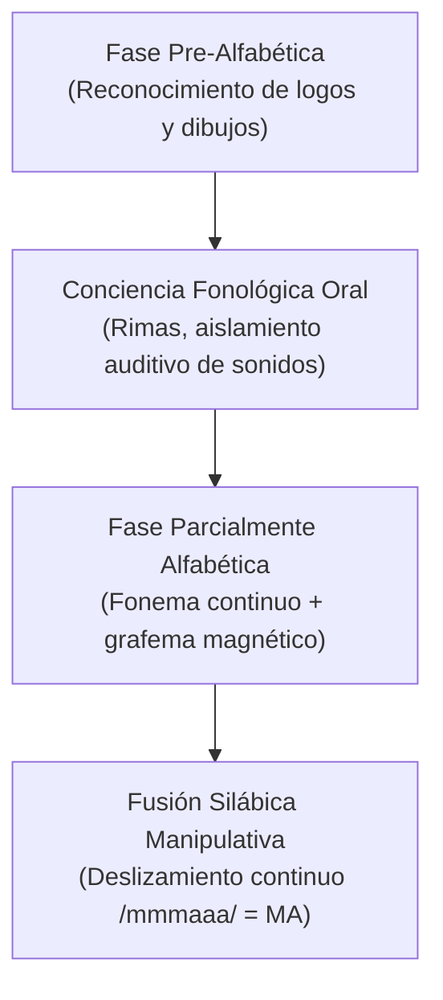
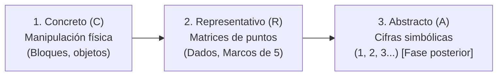
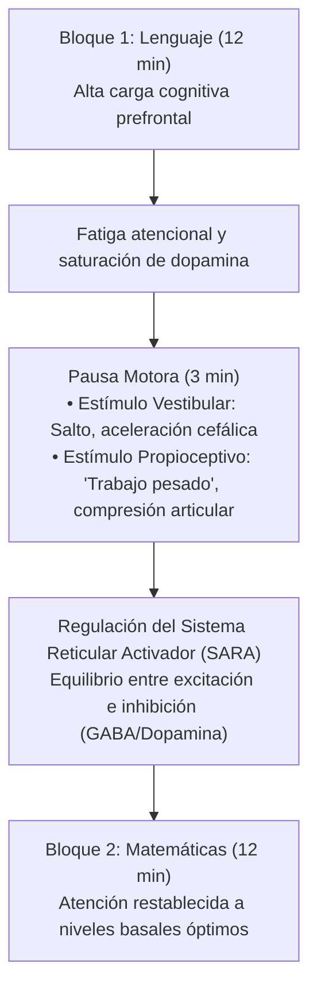
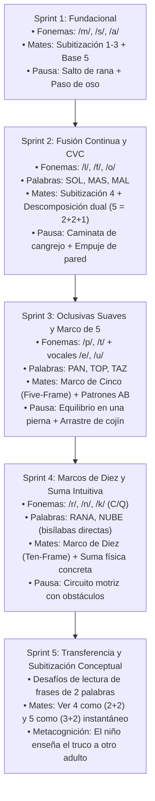

# Alpha Kids (3 Años) — Método de Estimulación Diaria en 30 Minutos

> **Adaptación científica y práctica del modelo Alpha School (Austin, TX) para la etapa preescolar temprana (3 años).**  
> Sin pantallas para el niño, aprendizaje por dominio (*Mastery Learning*), neurobiología de la atención, método fónico sistemático, subitización y el adulto como software adaptativo en tiempo real.

[](./index.html)
[](LICENSE)
[](#2-estructura-de-la-sesión-diaria-30-minutos)
[](#1-fundamentos-metodológicos-y-neurociencia-aplicada)

---

## 📖 Tabla de Contenidos
1. [Fundamentos Metodológicos y Neurociencia Aplicada](#1-fundamentos-metodológicos-y-neurociencia-aplicada)
   * 1.1. De Alpha School (Austin) al Hogar Preescolar
   * 1.2. Ciencia de la Lectura: Modelo Fónico Sintético (Ehri & Orton-Gillingham)
   * 1.3. Sentido Numérico Temprano: Subitización y Marco CRA (Clements & Sarama, Bruner)
   * 1.4. Neurobiología de la Atención y Pausas Sensoriomotoras (Propioceptiva y Vestibular)
   * 1.5. Psicología del Coaching Infantil y la Regla del Pico-Final (Dweck & Kahneman)
2. [Estructura de la Sesión Diaria (30 Minutos)](#2-estructura-de-la-sesión-diaria-30-minutos)
3. [Catálogo Inicial de Actividades (Sprint 1)](#3-catálogo-inicial-de-actividades-sprint-1)
4. [Matriz Generadora de Futuros Sprints (Blueprint Evolutivo)](#4-matriz-generadora-de-futuros-sprints-blueprint-evolutivo)
   * 4.1. Arquitectura de Niveles (Sprint 1 al 5)
   * 4.2. Puertas de Dominio (*Mastery Gates*): Cuándo Avanzar y Cuándo Consolidar
   * 4.3. Plantilla Metodológica para Crear Nuevos Retos
5. [Aplicación Web Progresiva (PWA)](#5-aplicación-web-progresiva-pwa)
6. [Cómo Desplegar o Usar Localmente](#6-cómo-desplegar-o-usar-localmente)

---

## 1. Fundamentos Metodológicos y Neurociencia Aplicada

### 1.1. De Alpha School (Austin) al Hogar Preescolar
En Austin (Texas), **Alpha School** demostró que condensar los aprendizajes académicos fundamentales en una franja matutina intensiva y personalizada de **2 horas** (*2-Hour Learning*) libera el resto del día para el desarrollo de habilidades vitales, deporte, proyectos y curiosidad espontánea.

A los 3 años, la jornada de 2 horas resulta excesiva para el umbral neurológico. La transposición matemática y pedagógica exacta es el **Sprint Diario de 30 Minutos**:
* **Alta densidad de aprendizaje activo:** El niño no escucha lecciones pasivas; resuelve desafíos manipulativos con sus propias manos y su voz.
* **El adulto como software adaptativo (*Human-in-the-loop*):** Alpha School utiliza algoritmos adaptativos que suben o bajan la dificultad en tiempo real. A los 3 años **no se usan pantallas para el niño**. El padre o madre asume el rol del motor adaptativo: monitoriza micro-expresiones, modula el andamiaje (*scaffolding* de Vygotsky) y ajusta el reto en la Zona de Desarrollo Próximo (ZDP).
* **«Tiempo Recuperado» (*Time Back*):** Finalizados los 30 minutos, la carga académica del día está cumplida al 100%. El resto del día se dedica a juego libre desestructurado, exploración al aire libre y vida familiar.

---

### 1.2. Ciencia de la Lectura: Modelo Fónico Sintético (Ehri & Orton-Gillingham)
A los 3 años, la mayoría de los niños se encuentran en la **Fase Pre-Alfabética** (Linnea Ehri): reconocen marcas visuales por contexto (el logo de una tienda o un dibujo), pero no decodifican texto.



#### Claves críticas para evitar errores pedagógicos:
1. **Consonantes continuas frente a oclusivas:**
   * Las consonantes **continuas** (`/m/`, `/s/`, `/f/`, `/l/`, `/r/`, `/n/`) permiten sostener la sonoridad con la voz sin interrumpir el flujo de aire (`/mmmmmm/`). Son las únicas aptas para iniciar la fusión silábica en edades tempranas.
   * Las consonantes **oclusivas o plosivas** (`/p/`, `/t/`, `/k/`, `/b/`, `/d/`, `/g/`) cortan el flujo de aire de golpe. Si se introducen antes de tiempo, los adultos suelen añadir la vocal neutra parásita o *schwa* (decir *«puh»* en vez de `/p/`), distorsionando por completo la decodificación (*«puh-a»* no suena *«pa»*).
2. **Fonemas puros frente a nombres de letras:**
   * Nunca se enseña que la letra se llama *«ese»* o *«eme»*. Se enseña exclusivamente su sonoridad acústica (`/sssss/`, `/mmmmm/`).
3. **El riesgo de las tarjetas visuales (*Flashcards* de palabras completas):**
   * Memorizar siluetas globales de palabras genera una falsa ilusión de lectura veloz, pero sobrecarga la memoria visual pasiva y colapsa hacia los 8 o 9 años cuando el vocabulario crece. El mapeo ortográfico real (asociar el fonema auditivo al grafema táctil) construye los circuitos neurológicos de la decodificación lectora definitiva.

---

### 1.3. Sentido Numérico Temprano: Subitización y Marco CRA (Clements & Sarama, Bruner)
El modelo matemático se fundamenta en las investigaciones de Douglas Clements y Julie Sarama (*Learning Trajectories in Early Mathematics*) y el enfoque CRA (Jerome Bruner):



#### Niveles evolutivos de subitización (3 a 4 años):
* **Identificador de colecciones pequeñas (*Small Collection Namer*):** Nombra cantidades de 1 a 3 elementos sin necesidad de contar uno a uno con el dedo.
* **Subitizador perceptual (*Perceptual Subitizer to 4*):** Identifica de un solo golpe de vista colecciones de hasta 4 elementos expuestas durante menos de 2 segundos.
* **Hacia la subitización conceptual (*Conceptual Subitizing*):** Capacidad de descomponer visualmente un conjunto (ej.: ver 4 como un grupo de 2 y otro de 2, o 5 como 4 y 1).

#### Álgebra intuitiva temprana (Conservación y descomposición):
Antes de escribir sumas o restas con símbolos algebraicos (`+`, `-`, `=`), el cerebro infantil comprende el concepto de **operación inversa** y **término desconocido** mediante el juego del vaso opaco:
$$\text{Total conocido (5)} = \text{A la vista (3)} + \text{Oculto bajo el vaso (?)}$$
El niño deduce mentalmente que $5 - 3 = 2$ por manipulación física, sentando las bases profundas del pensamiento algebraico.

---

### 1.4. Neurobiología de la Atención y Pausas Sensoriomotoras (Propioceptiva y Vestibular)
El córtex prefrontal a los 3 años tiene una ventana de atención sostenida de **2 a 3 minutos por año de edad** (entre 6 y 9 minutos de concentración máxima antes de la fatiga atencional). Dividir la sesión en dos bloques de 12 minutos exige un **reinicio neurofisiológico intermedio**:



* **Sistema Vestibular (Oído interno y equilibrio):** Movimientos rápidos de cambio de plano de la cabeza (saltos de rana, equilibrio, giros suaves). Despierta el sistema de alerta cortical (*arousal*).
* **Sistema Propioceptivo («Trabajo Pesado» o *Heavy Work*):** Receptores en músculos y articulaciones al empujar, reptar, cargar cojines pesados o recibir abrazos firmes. Envía señales calmantes al sistema nervioso central, reduce la sobreexcitación y enfoca la mente para la segunda mitad de la sesión.

---

### 1.5. Psicología del Coaching Infantil y la Regla del Pico-Final (Dweck & Kahneman)
* **Mentalidad de Crecimiento (*Growth Mindset* - Carol Dweck):** El adulto nunca etiqueta (*«Eres un genio»* o *«Qué listo eres»*). Elogia la estrategia y la perseverancia operativa: *«¡Te diste cuenta de que faltaban dos bloques mirando fijamente!»* o *«Me encantó cómo alargaste el sonido hasta juntarlo»*.
* **La Regla del Pico-Final (*Peak-End Rule* - Daniel Kahneman):** La memoria humana evalúa las experiencias principalmente por su momento más intenso (*peak*) y su final (*end*). Terminar la sesión justo cuando el niño dice *«¡otra vez, papá!»* garantiza que en su hipocampo quede registrada una vivencia de triunfo y fascinación. Al día siguiente, será él quien pida sentarse a jugar.

---

## 2. Estructura de la Sesión Diaria (30 Minutos)

| Tiempo | Módulo | Objetivo Neurocognitivo | Dinámica Manipulativa |
| :---: | :--- | :--- | :--- |
| **12 min** | **Bloque 1: Lenguaje Fónico** | Conciencia fonológica, aislamiento de fonemas continuos y fusión silábica física. | Manipulación de letras magnéticas en plano vertical (nevera/pizarra) o mesa. Arrastre sonoro continuo. |
| **3 min** | **Pausa Sensoriomotora** | Reseteo vestibular (alerta) + propioceptivo (calma y propiocepción). | Retos físicos de «trabajo pesado»: saltos de rana, paso de oso, equilibrio con cojín en cabeza. |
| **12 min** | **Bloque 2: Matemáticas** | Percepción cuantitativa inmediata (subitización perceptual 1-4) y álgebra intuitiva (base 5). | Bloques de construcción idénticos, dados de puntos clásicos y juego de descomposición con vaso opaco. |
| **3 min** | **Cierre & Recogida** | Regla del pico-final, validación del esfuerzo y autonomía compartida. | Celebración breve, chocar los cinco y ritual de ordenar juntos los materiales en su caja. |

---

## 3. Catálogo Inicial de Actividades (Sprint 1)

### 🅰️ Reto 1: El Radar de Sonidos
* **Área:** Lenguaje / Conciencia fonológica inicial
* **Duración:** 6 a 8 minutos
* **Materiales:** Letras magnéticas (**M**, **S**, **A**)
* **Mecánica:**
  1. Fijar únicamente la letra **M** magnética en la nevera o pizarra.
  2. Emitir el fonema continuo: *«Esta letra suena /mmmmm/, como cuando la comida huele deliciosa»*.
  3. Desafío exploratorio: buscar por la habitación 2 objetos que comiencen por `/mmmmm/` (*manzana*, *mantel*, *muñeco*).
* **🎯 Señal de dominio:** Identifica el fonema `/m/` en menos de 2 segundos al ver la pieza física y propone espontáneamente palabras cotidianas con ese sonido.

### 🔤 Reto 2: El Salto a la Lectura (Fusión Silábica)
* **Área:** Lenguaje / Decodificación fónica
* **Duración:** 4 a 6 minutos
* **Materiales:** Letras magnéticas **M** y **A**
* **Mecánica:**
  1. Disponer la **M** y la **A** sobre la mesa separadas 25 cm.
  2. Deslizar el dedo sosteniendo la voz: *«/mmmmmm/...»* y al alcanzar la A: *«.../aaaaa/»*.
  3. Acercar las piezas hasta que choquen: *«¡MA!»*.
  4. Conectar con el significado: *«¡Mira, hemos formado el principio de mamá y de manzana!»*.
* **🎯 Señal de dominio:** El niño arrastra las dos letras de forma autónoma con los dedos mientras pronuncia el sonido continuo sin cortes intermedios.

### 🐸 Reto 3: Desafío Motor Express
* **Área:** Transición / Regulación sensoriomotora
* **Duración:** 2 a 3 minutos
* **Materiales:** Pasillo despejado o cojines
* **Mecánica:**
  1. Anuncio lúdico: *«¡Pausa relámpago de energía animal!»*.
  2. Fase 1 (Vestibular): Cruzar el pasillo a saltos de rana o caminar en puntillas como gigantes.
  3. Fase 2 (Propioceptiva): Empujar un cojín pesado por el suelo o caminar a cuatro patas como un oso.
  4. Dos respiraciones lentas inflando la barriga antes de sentarse en la alfombra.
* **🎯 Señal de dominio:** Se sienta de nuevo en calma, con respiración serena y foco listo para el bloque de lógica.

### 🎲 Reto 4: Torres Relámpago (Subitización)
* **Área:** Matemáticas / Percepción cuantitativa inmediata
* **Duración:** 6 minutos
* **Materiales:** 1 dado clásico de puntos y 10 bloques idénticos
* **Mecánica:**
  1. Lanzar el dado (iniciando con valores de 1 a 3).
  2. Dejar el dado visible durante 2 segundos y taparlo con la palma: *«¿Cuántos puntos viste?»*.
  3. Desafío motor: coger de un solo agarre esa misma cantidad de bloques y construir una torre, sin contar uno a uno con el dedo.
  4. Ampliar progresivamente a 4 puntos.
* **🎯 Señal de dominio:** Agrupa 3 o 4 bloques de una sola intención motora sin enumerar verbalmente.

### 🏺 Reto 5: La Descomposición del Tesoro
* **Área:** Matemáticas / Álgebra temprana y conservación
* **Duración:** 6 minutos
* **Materiales:** 5 bloques y 1 vaso de plástico opaco
* **Mecánica:**
  1. Entregarle exactamente 5 bloques: *«Este es tu equipo de 5 exploradores»*.
  2. Explorar particiones abiertas: separar en 3 y 2 o 4 y 1, comprobando que el total de 5 permanece inalterado.
  3. Esconder 2 bloques bajo el vaso y dejar 3 a la vista.
  4. Pregunta inductiva: *«Si teníamos 5 y aquí veo 3... ¿cuántos están atrapados en el vaso?»*.
* **🎯 Señal de dominio:** Deduce la cantidad oculta mentalmente con seguridad antes de levantar el vaso.

---

## 4. Matriz Generadora de Futuros Sprints (Blueprint Evolutivo)

Para asegurar la continuidad del proyecto conforme el niño consolide conceptos, se define una **matriz modular estructurada en 5 Sprints evolutivos**:

### 4.1. Arquitectura de Niveles



#### Detalle de los Próximos Sprints a Generar:

| Nivel | Eje Lenguaje (12 min) | Eje Sensoriomotor (3 min) | Eje Matemáticas (12 min) | Criterio de Dominio Clave |
| :---: | :--- | :--- | :--- | :--- |
| **Sprint 1** *(Actual)* | Fonemas continuos `/m/`, `/s/`, `/a/`. Fusión silábica directa (`MA`, `SA`). | Salto vestibular (rana) + compresión propioceptiva (oso). | Subitización perceptual 1 a 3. Descomposición base 5 con 1 vaso. | Reconoce fonemas en <2s y deduce bloque oculto en vaso. |
| **Sprint 2** | Añadir `/l/`, `/f/`, `/o/`. Formación de palabras CVC continuas: *SOL*, *MAS*, *MAL*, *OLA*. | Caminata de cangrejo (apoyo inverso) + empuje firme contra pared. | Subitización perceptual consolidada hasta 4. Descomposición de 5 con dos vasos (3 piezas repartidas en 2 vasos). | Decodifica palabras CVC continuas arrastrando el dedo sin cortar el aire. |
| **Sprint 3** | Introducción cuidadosa de oclusivas suaves `/p/`, `/t/` y vocales `/e/`, `/u/`. Lectura de *PAN*, *TOS*, *PIE*. | Carrera en zigzag esquivando cojines + arrastre de caja con peso. | Introducción del **Marco de Cinco** (*Five-Frame*) físico con fichas bicolores. Patrones alternados AB (rojo-azul). | Rellena el marco de cinco reconociendo al instante cuánto falta para llenarlo. |
| **Sprint 4** | Fonemas `/r/`, `/n/`. Fusión silábica doble en palabras bisílabas transparentes: *RANA*, *SOPA*, *LUNA*. | Desafío de equilibrio sobre línea de cinta adhesiva + balanceo controlado. | Transición al **Marco de Diez** (*Ten-Frame*). Álgebra intuitiva de base 10 (ej.: 7 fichas $\rightarrow$ faltan 3 para 10). | Resuelve sumas tangibles manipulando fichas en el marco de diez sin contar de una en una. |
| **Sprint 5** | Lectura de micro-frases de 2 palabras (*«EL SOL SALE»*). Autonomía lectora en pizarra magnética. | Circuito motor completo (gateo por debajo de mesa + salto a cojín + abrazo firme). | Subitización conceptual: reconoce grupos de 4 o 5 al identificar subgrupos (ej.: *«veo 2 y 2, son 4»*). | **El niño hace de profesor**: le explica las reglas del juego a su madre/padre con sus propias palabras. |

---

### 4.2. Puertas de Dominio (*Mastery Gates*): Cuándo Avanzar y Cuándo Consolidar
Inspirado en la política de Alpha School (donde solo se avanza tras demostrar un 90%+ de dominio comprobado), en este método se aplican **3 reglas de oro de avance**:

1. **La Regla de los 3 Días Consecutivos:** No se pasa a un nuevo Sprint porque haya resuelto una actividad una sola vez. Debe responder con soltura y alegría durante **3 sesiones consecutivas**.
2. **Latencia inferior a 2 segundos:** En discriminación fonológica y subitización, si el niño tarda más de 3 segundos o cuenta con el dedo uno a uno, significa que aún está usando cálculo secuencial forzado. Se mantiene el nivel actual mediante juegos variados.
3. **Cero frustración observable:** Si aparecen signos de sobrecarga cognitiva (apartar la mirada, desinterés súbito, frotarse los ojos), el adulto reduce inmediatamente la dificultad dando un paso atrás en el andamiaje (*«Vamos a probar con 2 bloques en vez de 4»*).

---

### 4.3. Plantilla Metodológica para Crear Nuevos Retos
Cualquier nuevo reto que se diseñe para la plataforma debe cumplir obligatoriamente esta estructura de 5 variables:

```markdown
### [Nombre del Reto]
* **Área:** Lenguaje Fónico / Pausa Sensoriomotora / Sentido Numérico
* **Duración:** Entre 3 y 8 minutos
* **Materiales Requeridos:** Material manipulativo tangible concreto (sin pantallas)
* **Mecánica Paso a Paso:**
  1. Activación lúdica / planteamiento del misterio
  2. Manipulación física guiada
  3. Deducción autónoma del niño
* **🎯 Señal de Dominio (Mastery Gate):** Comportamiento observable medible en latencia y autonomía
* **Micro-Andamiaje:** 
  - Si es muy fácil: [Cómo elevar la dificultad en 5 segundos]
  - Si hay frustración: [Cómo descomponer el reto en un micro-paso más sencillo]
```

---

### 4.4. Referencias Bibliográficas y Publicaciones Científicas

* **Bloom, B. S. (1984).** *The 2 Sigma Problem: The Search for Methods of Group Instruction as Effective as One-to-One Tutoring.* Educational Researcher, 13(6), 4–16. Evidencia fundamental de que la tutoría individualizada y el dominio (*Mastery Learning*) elevan el rendimiento 2 desviaciones típicas sobre la enseñanza pasiva.
* **Ehri, L. C. (2005).** *Development of Sight Word Reading: Phases and Findings.* In M. J. Snowling & C. Hulme (Eds.), *The Science of Reading: A Handbook* (pp. 135–154). Blackwell. Modelo evolutivo de 4 fases de la lectura y necesidad del mapeo ortográfico fonema-grafema frente a la memorización visual pasiva.
* **Clements, D. H., & Sarama, J. (2009 / 2014).** *Learning and Teaching Early Math: The Learning Trajectories Approach.* Routledge. Trayectorias del desarrollo matemático temprano y la subitización perceptual como cimiento indispensable de la cardinalidad y el cálculo mental.
* **Bruner, J. S. (1966).** *Toward a Theory of Instruction.* Harvard University Press. Marco pedagógico CRA (Concreto, Icónico/Representativo y Simbólico/Abstracto) para la internalización cognitiva.
* **Ayres, A. J. (1972 / 2005).** *Sensory Integration and the Child.* Western Psychological Services. Función del sistema vestibular y propioceptivo en la modulación del sistema nervioso central y la autorregulación atencional en la infancia temprana.
* **Dweck, C. S. (2006).** *Mindset: The New Psychology of Success.* Random House. Impacto del elogio al esfuerzo estratégico frente al elogio a la capacidad en la motivación intrínseca y la resiliencia infantil.
* **Kahneman, D. (2011).** *Thinking, Fast and Slow.* Farrar, Straus and Giroux. La Regla del Pico-Final (*Peak-End Rule*), heurística por la cual el ser humano evalúa las experiencias según el punto álgido y el momento de cierre.
* **Vygotsky, L. S. (1978).** *Mind in Society: The Development of Higher Psychological Processes.* Harvard University Press. Zona de Desarrollo Próximo (ZDP) y andamiaje adaptativo guiado por un facilitador humano.

---

## 5. Aplicación Web Progresiva (PWA)

El repositorio incluye una **PWA completa e interactiva** ([index.html](./index.html)) diseñada para apoyar la ejecución fluida de la sesión diaria desde el teléfono móvil:

* ⏱️ **Cronómetro adaptativo por fases (30 min):** Secuencia preprogramada con las 4 etapas (12 min $\rightarrow$ 3 min $\rightarrow$ 12 min $\rightarrow$ 3 min) con tipografía gigante de alta legibilidad sobre mesa.
* 🌓 **Modo Claro y Modo Oscuro:** Conmutador táctil inmediato (`☀️`/`🌙`) en la cabecera, adaptado para uso con luz natural diurna o luz tenue, con persistencia en `localStorage` y detección de preferencia del sistema operativo.
* 🔔 **Síntesis de audio y vibración táctil:** Campanas armónicas suaves generadas en tiempo real mediante **Web Audio API** (100% autónomas, sin archivos MP3 externos) y vibración háptica al finalizar cada bloque.
* 💡 **Coach pedagógico en vivo:** Tarjeta contextual que recuerda el foco didáctico y la regla de oro del bloque en curso.
* 🧩 **Catálogo modular interactivo:** Actividades con filtros por área, pasos detallados, señales de dominio y botón de seguimiento diario (*«Practicado hoy»*).
* ➕ **Formulario de nuevos retos:** Permite a la familia crear e insertar nuevos juegos directamente desde el móvil a medida que el niño supere los niveles.
* 📈 **Registro de sesiones y cálculo de racha:** Historial local persistente con anotaciones pedagógicas y cálculo de constancia diaria.
* 💾 **100% Offline (Service Worker):** Funciona íntegramente en modo avión o sin cobertura una vez visitada la web.

### Cómo instalar la PWA en tu móvil:
* **En Chrome / Android:** Abre la web en el navegador, pulsa el menú de tres puntos `⋮` y selecciona **«Añadir a la pantalla de inicio»** o **«Instalar aplicación»**.
* **En Safari / iOS:** Abre la web en Safari, pulsa el botón **Compartir** (icono con cuadrado y flecha hacia arriba) y selecciona **«Añadir a pantalla de inicio»**.

---

## 6. Cómo Desplegar o Usar Localmente

### Opción 1: Abrir directamente en el navegador
Haz doble clic sobre el archivo `index.html` o ábrelo desde cualquier navegador moderno (Chrome, Safari, Firefox, Edge).

### Opción 2: Servidor local ligero (para probar en el móvil por Wi-Fi)
```bash
# Con Python 3
python3 -m http.server 8080

# Abre en el navegador de tu teléfono móvil: http://<ip-de-tu-pc>:8080
```

### Opción 3: Despliegue gratuito en GitHub Pages
1. Sube este repositorio a tu cuenta de GitHub.
2. Accede a **Settings** > **Pages**.
3. En *Source*, selecciona la rama `main` y el directorio `/ (root)`.
4. En pocos segundos tendrás tu URL segura con HTTPS (`https://tu-usuario.github.io/mschool/`), habilitando la instalación instantánea como PWA en tu teléfono.

---

*Diseñado con rigor pedagógico, evidencia neurocientífica y amor por el aprendizaje temprano.*
